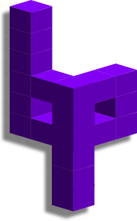

# Bitpacker

[](https://github.com/jonasblixt/bpak/actions/workflows/build.yml)
[](https://scan.coverity.com/projects/jonasblixt-bpak)

Bitpacker, or bpak, is a C library, a python package and a command line tool
for signed firmware packages, primarily for embedded systems.

An embedded system is often composed of several software components: a
bootloader, a kernel, file systems, device configuration and applications,
each with its own format and tools. A bpak package holds all of them as parts,
together with meta data, in a format that a bootloader can verify:

- **Signed packages.** ECDSA (P-256, P-384, P-521) or RSA 4096 signatures
  over a sha256, sha384 or sha512 hash. Packages can be signed with keys on
  disk during development, and release candidates can be signed again by an
  external signing service or HSM without being rebuilt.
- **Meta data.** Package type and version, load addresses or any
  application specific data, protected by the signature.
- **dm-verity.** Merkle hash trees for file system images, compatible with
  the Linux dm-verity device mapper target.
- **Small updates.** Packages can be transport encoded with binary diffs
  against the installed version. The device decodes the update as it is
  received and gets a package that is identical to the original, signature
  included.
- **Keystores.** Sets of public keys in a package, which can be compiled into
  a bootloader or loaded at runtime to extend the root of trust.

The library is small and depends neither on a file system nor on a
particular crypto library, which makes it suitable for bootloaders, for
example [punchboot](https://github.com/jonasblixt/punchboot).

bpak is not a package manager. It provides the package format and the
primitives to verify and update packages. How packages are installed is up
to the system that uses them.

## Installation

The `bpak` tool is part of the bpak python package. Install it from the
repository root with [uv](https://docs.astral.sh/uv), which puts it in an
isolated environment, or with pip:

```
$ uv tool install .
$ pip install .
```

The package is built with CMake and includes the library. The build needs
Python 3.10 or later, a C compiler and the mbedtls and liblzma development
packages, for example `libmbedtls-dev` and `liblzma-dev` on Debian and
Ubuntu.

Build and install the C library:

```
$ cmake -B build
$ cmake --build build
$ sudo cmake --install build
```

## Example

```
$ bpak create demo.bpak
$ bpak add demo.bpak --meta bpak-version --from-string 1.0.0
$ bpak add demo.bpak --part kernel --from-file kernel.bin
$ bpak sign demo.bpak --key prime256v1-key-pair.pem
$ bpak verify demo.bpak --key prime256v1-public-key.der
Verification OK
```

## Documentation

- [User guide](docs/user-guide.md): the `bpak` tool, step by step
- [Package format](docs/format.md): parts, meta data, ids, signing and
  transport encoding
- [C library](docs/c-library.md): architecture, building and using the
  library
- [Python package](docs/python.md): the python API
- [Development](docs/development.md): building, testing and contributing

## License

BSD-3-Clause, see [LICENSE](LICENSE). The library includes third-party code
under other licenses, see [LICENSES](LICENSES):

- binary diff and patch (`lib/bsdiff.c`, `lib/bspatch.c`), based on bsdiff
  by Colin Percival and Matthew Endsley: BSD-2-Clause
- heatshrink compression by Scott Vokes (`lib/vendor/heatshrink`): ISC
- sais-lite suffix array construction by Yuta Mori (`lib/vendor/sais`): MIT
