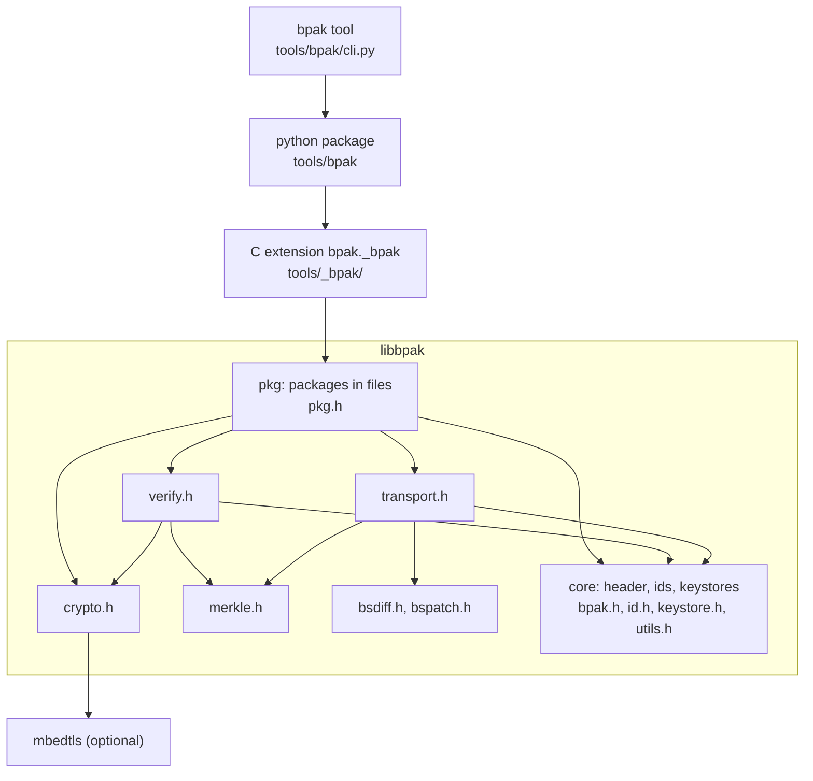

# C library

`libbpak` reads, creates, signs, verifies and transport encodes and decodes
packages. The public headers in [`include/bpak/`](../include/bpak) document
every function, this page gives an overview.

## Architecture



The lower layers do not depend on files or on a particular crypto library.
A bootloader typically uses the core and the verify and transport layers
with I/O callbacks and its own hash and signature implementation, while the
`pkg` layer works on files and is used by tools. A bootloader compiles the
sources it needs, see
[Building the library into another project](#building-the-library-into-another-project).
The CMake option `BPAK_BUILD_MINIMAL` builds only the core.

| Header       | Contents                                                                 |
|--------------|--------------------------------------------------------------------------|
| `bpak.h`     | The header structs, constants and error codes; parts and meta data in a header |
| `id.h`       | `bpak_id()` and the ids of known meta data and transport algorithms     |
| `pkg.h`      | Packages in files: open, add parts, sign, verify, transport encode and decode |
| `verify.h`   | Header and payload hashes and merkle tree verification, with I/O callbacks |
| `crypto.h`   | Hash and signature functions and how to replace the backend             |
| `key.h`, `keystore.h` | Public keys and keystores                                      |
| `transport.h` | Streaming transport decoder, transport encoder                         |
| `merkle.h`   | Merkle hash tree generation                                              |
| `bsdiff.h`, `bspatch.h` | Binary diff and patch                                         |
| `utils.h`    | Conversions to strings and hash tree ids                                 |

## Building and installing

The library depends on mbedtls and liblzma, for example `libmbedtls-dev` and
`liblzma-dev` on Debian and Ubuntu:

```
$ cmake -B build
$ cmake --build build
$ sudo cmake --install build
```

This installs the shared and the static library, the headers in
`include/bpak/` and a pkg-config file:

```
$ cc -o app app.c $(pkg-config --cflags --libs bpak)
```

CMake options:

| Option               | Description                                                          |
|----------------------|----------------------------------------------------------------------|
| `BPAK_BUILD_MINIMAL` | Build only the core: header, ids, keystores and utilities, without dependencies |
| `BPAK_BUILD_TESTS`   | Build the tests, the examples and the C extension of the python package, see [Development](development.md) |
| `BPAK_WERROR`        | Treat compiler warnings as errors, ON by default                     |

`BPAK_CHUNK_BUFFER_LENGTH` sets the size of the buffers that are used to read
part data, 4096 bytes by default. Define it on the compiler command line to
change it.

### Building the library into another project

Bootloaders and other projects that do not use CMake can compile the sources
in `lib/` and `lib/vendor/` directly. Define `BPAK_HAVE_USER_SETTINGS` and
provide two headers in the include path:

- `bpak_user_settings.h`, which replaces the generated
  `bpak/build_config.h` and defines `BPAK_CONFIG_MERKLE`, `BPAK_CONFIG_LZMA`
  and `BPAK_CONFIG_MBEDTLS` to 0 or 1
- `bpak/version.h`, see [`lib/version.h.in`](../lib/version.h.in)

Without mbedtls, register a hash and signature implementation with
`bpak_hash_setup()` and `bpak_crypto_setup()` from `crypto.h`, for example one
that uses a hardware crypto accelerator. Without LZMA, `bsdiff-lzma` and
`bspatch-lzma` are not available.

## Using the library

### Reading a header

```c
#include <bpak/bpak.h>
#include <bpak/id.h>

struct bpak_header header;
struct bpak_meta_header *meta;

/* Read the first 4096 bytes of the package into 'header' */

if (bpak_valid_header(&header) != BPAK_OK)
    return -1;

if (bpak_get_meta(&header, BPAK_ID_BPAK_VERSION, 0, &meta) == BPAK_OK)
    printf("Version: %s\n", bpak_get_meta_ptr(&header, meta, char));

bpak_foreach_part (&header, part) {
    if (part->id == 0)
        continue;
    printf("Part %08x: %zu bytes at offset %lld\n", part->id,
           bpak_part_size_wo_pad(part),
           (long long)bpak_part_offset(&header, part));
}
```

[`examples/c_example.c`](../examples/c_example.c) is a complete program that
lists the meta data of a package, `c_example <package>`.

### Verifying a package file

```c
#include <stdlib.h>
#include <bpak/bpak.h>
#include <bpak/crypto.h>
#include <bpak/pkg.h>

struct bpak_package pkg;
struct bpak_key *key = NULL;
int rc;

rc = bpak_crypto_load_public_key("public-key.der", &key);
if (rc != BPAK_OK)
    return rc;

rc = bpak_pkg_open(&pkg, "demo.bpak", "rb");
if (rc == BPAK_OK) {
    rc = bpak_pkg_verify(&pkg, key);
    bpak_pkg_close(&pkg);
}

printf("%s\n", bpak_error_string(rc));
free(key); /* Allocated with bpak_calloc(), calloc() by default */
```

`bpak_pkg_verify()` is implemented with the functions in `verify.h`, which a
bootloader can use directly on a header in memory and a read callback:

1. `bpak_verify_compute_header_hash()` computes the header hash.
2. `bpak_crypto_verify()` checks the signature in the header against the
   hash, with a key that is selected with `key_id` and `keystore_id`, for
   example from a keystore that was generated with `bpak generate keystore`
   and `bpak_keystore_get()`.
3. `bpak_verify_payload()` reads the parts through the callback, compares
   the payload hash and checks the merkle hash trees.

### Transport decoding on a device

`transport.h` decodes a transport encoded package as a stream, so a device can
apply an update while it is downloaded without storing the encoded package:

1. `bpak_transport_decode_init()` with a work buffer, the header of the
   encoded package and callbacks that write and read the output.
2. `bpak_transport_decode_set_origin()` with the header of the installed
   package and a callback that reads it, for the diff based decoders.
3. For every part: `bpak_transport_decode_start()`, then
   `bpak_transport_decode_write_chunk()` with the encoded part data as it
   arrives, then `bpak_transport_decode_finish()`.
4. `bpak_transport_decode_free()`.

After decoding, verify the output package as described above.

### Errors and logging

Functions return `BPAK_OK` (0) or a negative `enum bpak_errors` value, and
`bpak_error_string()` describes an error.

The library logs through `bpak_printf(level, fmt, ...)`. The default
implementation is a weak symbol that discards the messages, define
`bpak_printf` in the application to print them.

Memory is allocated with `calloc` and `free` unless other functions are set
with `bpak_set_calloc_free()`.
